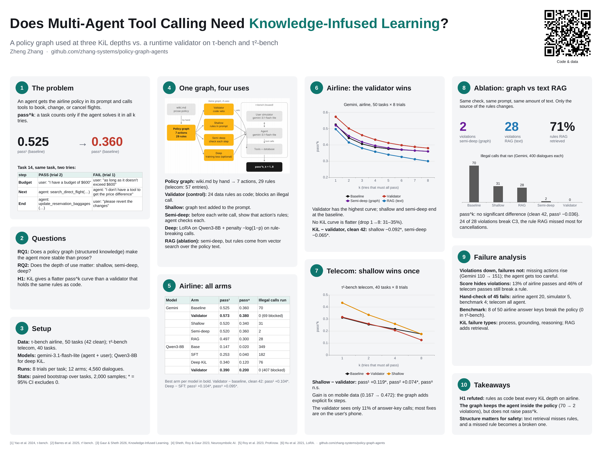
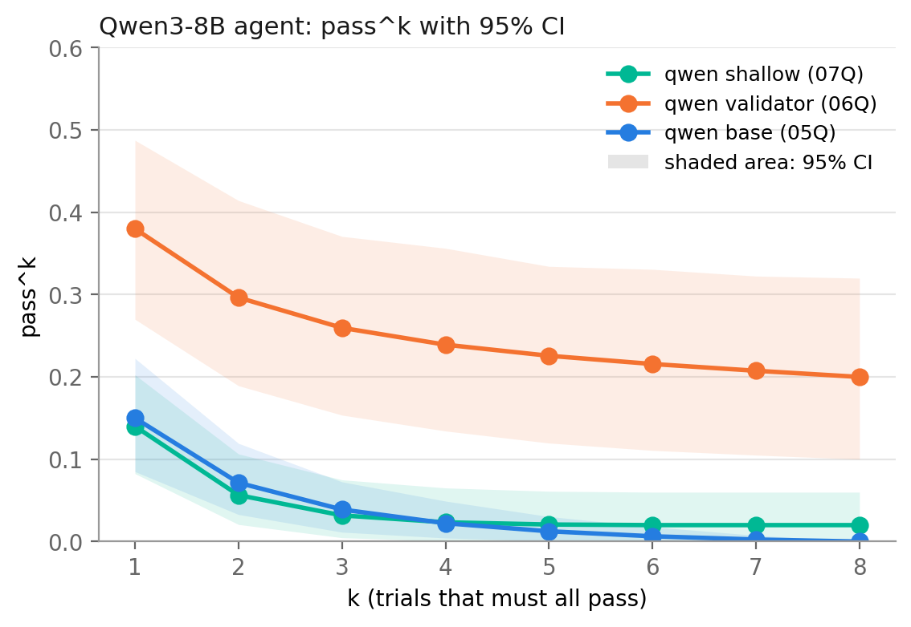
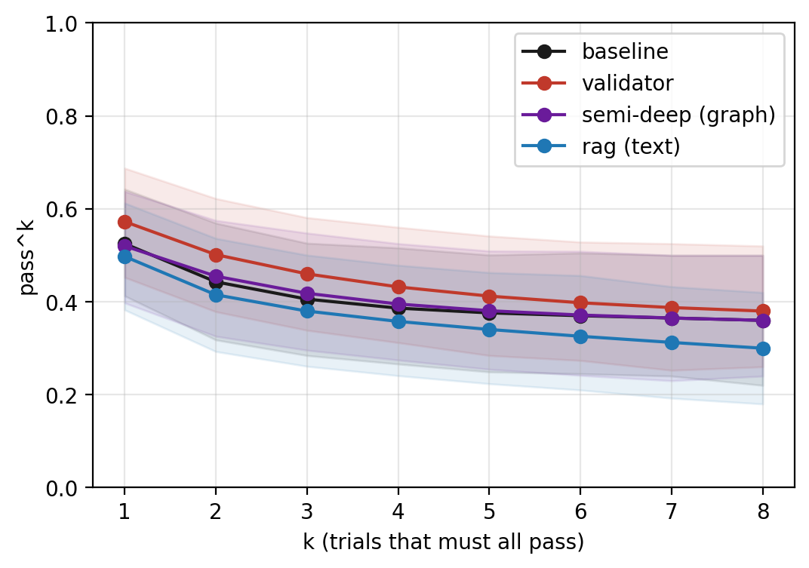
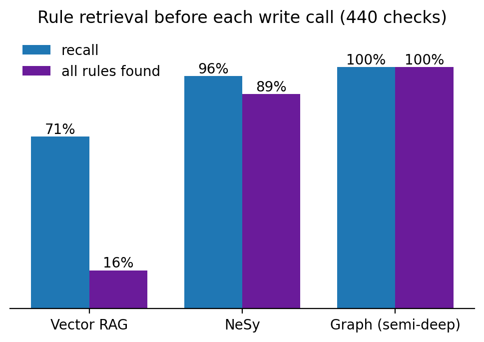
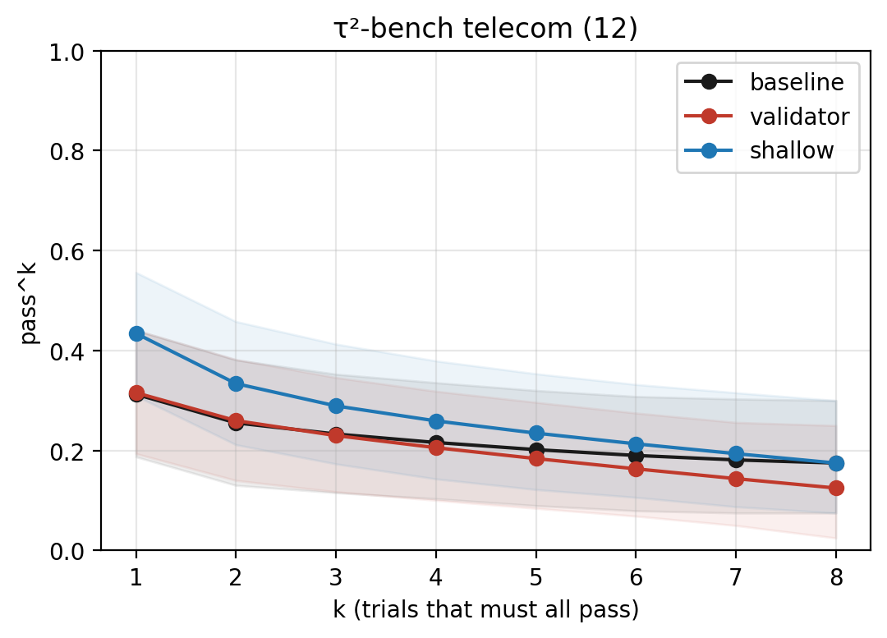

# policy-graph-agents

**Does turning an LLM agent's text policy into a graph make it follow the rules more consistently?**

An evaluation study of rule-following in LLM tool-calling agents on τ-bench airline, with paired bootstrap statistics and hand-checked failures. So far: 13 agent setups and 4,960 multi-turn dialogues.

I test this on the airline domain of [τ-bench](https://github.com/sierra-research/tau-bench). An LLM customer-service agent talks to an LLM-simulated customer and calls tools (book, change, cancel flights) on a real database. As a stretch goal, I repeat the main test on the telecom domain of τ²-bench, where the user also runs tools on their own phone.

The project has two parts:

- **Part 2, the main comparison (in progress):** five systems, all with the same open model (Qwen3-8B) as the agent: baseline, runtime validator, and three depths of knowledge infusion (shallow, semi-deep, deep). One model for every depth makes the comparison fair, and deep infusion needs model weights anyway.
- **Part 1, the earlier study (done):** the same question with Gemini as the agent, plus a RAG ablation, a neurosymbolic retriever, and the telecom domain. Its findings shaped Part 2.

## Status (2026-11-26)

| System | Notebook | Status | pass^1 | pass^8 |
|---|---|---|---|---|
| Baseline (prose policy) | 05Q | ✅ done (seeded rerun) | 0.147 | 0.000 |
| Runtime validator | 06Q | ✅ done (seeded rerun) | 0.405 | 0.180 |
| Shallow KiL | 07Q | ✅ done | 0.140 | 0.020 |
| Semi-deep KiL | 08Q | 🛠 being built | | |
| Deep KiL | 09Q | 🛠 being built | | |
| Comparison | 10Q | 🛠 being built | | |

## Demo (2:48)

https://github.com/user-attachments/assets/369d70c0-2beb-4179-b856-d330fdca0154

Real dialogues replayed side by side: the same task passing once and failing the next time, the validator blocking a cancellation the policy forbids, and graph rules vs. text retrieval (RAG) on the same task. *The demo and the poster show Part 1 (Gemini).*

## Poster

[](figures/poster.pdf)

One-page summary of Part 1, including the RAG and NeSy retrieval results. Click for the PDF.

## Situation

A customer-service agent gets a long policy written in plain text (`wiki.md`): "do not cancel a trip that has already been flown", "get an explicit yes from the user before you change anything", and so on.

The policy is already in the agent's prompt, but the agent does not follow it every time. τ-bench measures this with **pass^k**: a task counts only if the agent solves it in all k tries. In my baselines, the same task often passes in one try and fails in the next under the exact same settings.

## Task

- **RQ1:** If the policy is written as a graph (structured knowledge) instead of prose, does the agent become more consistent?
- **RQ2:** Does it matter how deeply the graph is used: only in the prompt (shallow), checked step by step before each action (semi-deep), or trained into the model (deep)?
- **H1:** If Knowledge-infused Learning (KiL) really helps, it should flatten the pass^k curve and cut violations more than a simple runtime validator: the same rules written as code that blocks bad tool calls. If the validator is just as good, the rules belong in code, not in the model.

## Part 2: one open model, five systems (in progress)

### Setup

- **Agent:** Qwen3-8B on vLLM 0.34.0, thinking off, temperature 0.0, hermes tool parser.
- **Customer:** the same Gemini user simulator (`gemini-3.1-flash-lite`) as in Part 1. Only the agent is tested.
- **Runs:** 50 tasks × 8 trials = 400 dialogues per system, concurrency 4.
- **Hardware:** one L4 (24 GB) on Colab. The context is 24k instead of 32k and `--max-num-seqs` is 8; both are saved with each run.
- **Statistics:** pass^k for k = 1..8 with 95% bootstrap CIs; paired comparisons over the same tasks.
- **Simulator seeds:** from 07Q on, trial t gives seed t to every user-simulator call (`qwen_run.py`), so the 8 trials use 8 different seeds and every system uses the same 8. Gemini accepts the seed and repeats a reply for the same seed. 05Q and 06Q are rerun with seeds (the first, unseeded runs are kept as `results_qwen_base_noseed` and `results_qwen_validator_noseed` for a seed check).

### The five systems

All five start from the same policy graph (`airline_policy_graph.json`, see Part 1).

| System | Where the policy enters | How |
|---|---|---|
| Baseline | prompt text | the prose policy, as τ-bench ships it |
| Runtime validator | code | the graph's 24 data rules check every write call and block illegal ones |
| Shallow KiL | prompt text | the graph rendered as explicit rules and added to the prompt |
| Semi-deep KiL | planning state | before each tool call, the agent states its plan, gets that action's rules from the graph, and checks each one against the request: holds, does not hold, or unknown. Only then does it reply or call the tool |
| Deep KiL | training objective | LoRA fine-tuning with an extra loss on calls whose graph preconditions are unmet |

Semi-deep KiL differs from the validator in one way: it shapes the plan **before** the call instead of blocking the call afterward. So it can also catch dialogue-level mistakes, such as acting without first explaining the change and getting a yes. If a rule does not hold, the agent tells the customer which one.

### Results so far: baseline (05Q), validator (06Q), shallow KiL (07Q), all seeded

| System | pass^1 (95% CI) | pass^8 | drop 1→8 | blocked calls | illegal calls run | write without a yes | passing dialogues with a violation |
|---|---|---|---|---|---|---|---|
| Baseline (seeded) | 0.147 [0.08, 0.22] | 0.000 | 100% | 0 | 363 | 359 of 598 | 3 of 59 |
| Baseline (no seed) | 0.150 [0.09, 0.22] | 0.000 | 100% | 0 | 339 | 342 of 571 | 5 of 60 |
| Runtime validator (seeded) | 0.405 [0.29, 0.51] | 0.180 | 56% | 390 | 0 | 261 of 422 | 0 of 162 |
| Runtime validator (no seed) | 0.380 [0.27, 0.49] | 0.200 | 47% | 347 | 0 | 215 of 422 | 0 of 152 |
| Shallow KiL | 0.140 [0.08, 0.20] | 0.020 | 86% | 0 | 462 | 396 of 654 | 8 of 56 |

"Write without a yes" counts bookings and changes that ran although the user's last message had no yes, confirm or go ahead.

**Seed check (notebooks 05Q and 06Q):** seeded − unseeded, paired over the same tasks, is not significant at any k for either system (also on the clean 42). Baseline: Δpass^1 = −0.003 [−0.048, +0.045]; both runs have 0 / 18 / 32 tasks that always / sometimes / never pass. Validator: Δpass^1 = +0.025 [−0.020, +0.075]; 9 / 23 / 18 vs 10 / 20 / 20. So adding seeds did not change either result.



Validator − baseline, paired over the same tasks (95% bootstrap CI, * = significant; notebook 06Q; both seeded):

| Tasks | Δpass^1 | Δpass^2 | Δpass^4 | Δpass^8 |
|---|---|---|---|---|
| all 50 | +0.258 [+0.155, +0.365] * | +0.234 [+0.132, +0.346] * | +0.205 [+0.106, +0.315] * | +0.180 [+0.080, +0.300] * |
| clean 42 | +0.307 [+0.193, +0.429] * | +0.279 [+0.161, +0.404] * | +0.244 [+0.129, +0.372] * | +0.214 [+0.095, +0.333] * |

Shallow KiL − validator and − baseline (notebook 07Q; compared with the unseeded 05Q and 06Q, to be recomputed with the seeded runs):

| Compare | Tasks | Δpass^1 | Δpass^2 | Δpass^4 | Δpass^8 |
|---|---|---|---|---|---|
| Shallow − validator | all 50 | −0.240 [−0.355, −0.130] * | −0.240 [−0.354, −0.135] * | −0.216 [−0.333, −0.108] * | −0.180 [−0.300, −0.060] * |
| Shallow − validator | clean 42 | −0.286 [−0.417, −0.161] * | −0.286 [−0.416, −0.163] * | −0.257 [−0.393, −0.131] * | −0.214 [−0.357, −0.071] * |
| Shallow − baseline | all 50 | −0.010 [−0.055, +0.033] | −0.015 [−0.057, +0.029] | +0.001 [−0.034, +0.049] | +0.020 [+0.000, +0.060] |
| Shallow − baseline | clean 42 | −0.012 [−0.065, +0.042] | −0.018 [−0.069, +0.035] | +0.001 [−0.041, +0.059] | +0.024 [+0.000, +0.071] |

Violations per 100 dialogues (notebooks 05Q, 06Q and 07Q, all seeded):

| Type | Violation | Baseline | Validator | Shallow |
|---|---|---|---|---|
| 1 | illegal call that ran | 90.8 | 0 | 115.5 |
| 2 | write without a yes | 89.8 | 65.2 | 99.0 |
| 2 | write without stating the details first | 97.5 | 71.5 | 114.8 |
| 2 | tool call and reply in one turn | 2.8 | 7.5 | 3.0 |
| 2 | recommendation phrase | 12.2 | 17.5 | 20.5 |
| 3 | write rejected by the database | 64.5 | 43.2 | 88.0 |
| 3 | any tool error | 106.5 | 83.0 | 117.0 |
| 3 | malformed call | 4.8 | 9.2 | 2.5 |

Type 2 and 3 are automatic proxies; I checked them by reading failed dialogues.

**What I found so far (Qwen3-8B)**

- **The baseline is not consistent at all.** No task passes in all 8 tries; 18 of 50 pass sometimes and 32 never pass. Illegal calls happen most in the middle and late parts of the dialogue (seeded run, early / middle / late: 95 / 122 / 146).
- **The validator lifts the whole curve.** pass^1 more than doubles (0.147 → 0.405), and pass^8 rises from 0 to 0.180: 9 tasks now pass every time. The drop from k = 1 to 8 falls from 100% to 56%. Every difference is significant, on all 50 tasks and on the 42 clean ones. On Gemini (Part 1) the validator raised pass^1 only. One reason: Qwen breaks rules much more often (363 illegal calls vs. Gemini's 70), and each blocked call tells the agent which rule it broke, so it can fix the call and try again.
- **It stops every rule break it can check.** 390 calls were blocked, none ran, and none of the 162 passing dialogues has an illegal call.
- **It cannot see the dialogue.** It makes fewer writes than the baseline (422 vs 598), but per write the share without an explicit yes is the same (62% vs 60%). A validator on tool calls cannot catch this. This is the gap semi-deep KiL is meant to close, and the line every KiL depth now has to beat.
- **Shallow KiL does not help an 8B model.** Adding the graph as a rule list to the prompt leaves pass^1 at the baseline's level (0.140 vs 0.147) and far below the validator (0.405). (The paired tests in the table above still use the unseeded runs; they will be recomputed.) One task now passes every time, so pass^8 is 0.020 instead of 0.
- **It makes the agent act more, not more carefully.** Compared with the seeded baseline, shallow runs more writes (1.64 vs 1.50 per dialogue), so it also runs more illegal calls (462 vs 363) and gets more writes rejected (352 vs 258). The share of writes without a yes does not change (61% vs 60%). A likely reason: the checklist adds about 1,100 words to every prompt, and an 8B model follows a long prompt less well. I saw tool-call loops in the failed dialogues.
- **Hand-check of 15 failed shallow dialogues:** the agent caused 14, the simulator 1. Most often the agent made up a user id, reservation id or flight number; changed a booking without a price or a yes; picked the wrong reservation or the wrong count; or repeated the same tool call. In the simulator case, the user kept asking for insurance after a correct refusal until the turn limit.
- **Same as Part 1, H1 does not hold so far.** On Gemini, shallow also stayed below the validator.
- **Runs.** A first baseline run with an older vLLM gave the same picture (pass^1 0.147, 338 illegal calls); I reran it so every Qwen system uses the same vLLM, and then once more with seeds, as I did for the validator. In the seeded baseline, trial 1 ran in two parts (16 + 34 tasks) because the Colab session stopped; both parts used seed 1 and the same settings, and the runner skips finished tasks, so no task ran twice. In the seeded validator run, 2 of 400 dialogues did not finish at first (one hit the 24k context limit, since blocked calls make dialogues longer; one got a tool reply τ-bench could not parse); both were rerun once and finished.

## Part 1: earlier study with Gemini (done)

The notebooks of Part 1's Gemini arms and the old Qwen deep-KiL notebook (05G–10) were removed from `main` to keep the repo focused on Part 2. They are still in the commit history. The saved Gemini dialogues stay in `results_gemini_*`.

### What I did

- **Built the policy graph.** I converted all 26 bullets of `wiki.md` into a graph: 7 actions, 29 rules, 19 "ask the user first" items, 6 OR/AND gates. Every rule keeps its source id (G1, C3, ...), and I checked each one against the original text. I tagged each rule as *data* (checkable from the database, 24 rules) or *dialogue* (only visible in the conversation, 5 rules). The graph is stored as JSON and loaded into Neo4j (70 nodes, 70 relationships).
- **Chose a model under a small budget.** I tried free options first (Groq API, Qwen3-8B, Qwen3-32B on Colab GPUs, free Gemini tiers) and recorded why each did not work. For Part 1 I used `gemini-3.1-flash-lite` through the paid API, after a 10-task pilot.
- **Ran every arm the same way.** Same agent, prompt and settings; 400 dialogues per arm.
- **Arms:** baseline; runtime validator (24 data rules as Python code); shallow KiL (graph as a rule list in the prompt); semi-deep KiL (before each write call, that action's rules are pulled from the graph and the agent checks them one by one); and a **RAG ablation**: the same check and the same amount of text, but the rules come from vector search over the 26 bullets of `wiki.md` (all-MiniLM-L6-v2).
- **NeSy retrieval (offline, notebook 15):** the RAG arm's logged vector hits are the seeds; the graph scores each action by its seed rules, keeps the best one, and returns that action's rules. No new agent runs, $0.
- **Read failed dialogues by hand** and **tested the benchmark itself** (see below).
- **Repeated the main test on τ²-bench telecom** (40 tasks × 8 trials): baseline, validator (5 data rules) and shallow KiL with a new telecom policy graph.

### Key results

- The validator (rules as code) has the best pass^k on airline. No KiL arm beats it, so H1 is refuted on Gemini.
- The policy graph still keeps the agent inside the policy: illegal calls fall from 70 to 2 with semi-deep KiL. But the agent gets more cautious and leaves more required actions undone, so pass^k does not rise.
- Swapping the graph for text retrieval (RAG) keeps pass^k about the same but lets 28 illegal calls through, because retrieval misses rules.
- A neurosymbolic retriever (vector seeds + graph) raises rule recall from 71% to 96%.
- On τ²-bench telecom, shallow KiL beats the validator at pass^1 (+0.119*), but not at pass^8.
- 8 of τ-bench's 50 airline answer keys break its own policy; τ²-bench fixed all 8.

**Takeaway so far:** put hard rules in code first. Use structured knowledge where code cannot see, such as dialogue rules and steps on the user's phone. Part 2 tests whether this holds when all depths use one open model; so far the validator is an even stronger line on Qwen than on Gemini.

### τ-bench airline, Gemini (50 tasks × 8 trials per arm)

| Arm | pass^1 | pass^8 | Drop 1→8 | Illegal tool calls executed |
|---|---|---|---|---|
| Baseline (prose policy) | 0.525 | 0.360 | 31% | 70 |
| Runtime validator | 0.573 | 0.380 | 34% | 0 (69 blocked) |
| Shallow KiL | 0.520 | 0.340 | 35% | 31 |
| Semi-deep KiL | 0.520 | 0.360 | 31% | 2 |
| RAG (ablation, notebook 14) | 0.497 | 0.300 | 40% | 28 |



### What I found (airline, Gemini)

- **H1 is refuted.** On the 42 clean tasks the validator is higher at every k; the gap is significant for shallow (k = 1, 2, 4) and semi-deep (k = 1).
- **The baseline is not consistent.** Gemini solves about half of the tasks once, but only about a third every time. 19 of 50 tasks pass in some trials and fail in others.
- **The validator** stops every checkable violation and raises pass^1 by about 10 points on the clean tasks (+0.104, 95% CI [+0.033, +0.185]). But pass^8 barely moves (+0.048, not significant).
- **KiL cuts violations, not failures.** Illegal calls fall from 70 to 31 (shallow) and 2 (semi-deep). Missing actions rise from 110 to 151 with semi-deep, so pass^k does not rise.
- **The graph's exact rule list is what stops violations (RAG ablation).** RAG and semi-deep differ only in where the rules come from. pass^k is about the same (clean 42: pass^1 −0.036, pass^8 −0.071, not significant), but RAG lets 28 illegal calls through vs. 2. RAG finds 71% of the rules the graph gives for an action, and all of them in only 16% of checks. For cancellations it most often misses C3 ("only a trip with no flown segment can be cancelled"), and 24 of its 28 violations break C3.
- **The graph can repair vector retrieval (NeSy, notebook 15, offline).** From the same 440 vector hits, letting the graph pick the action and add its rules raises recall from 71% to 96%, checks with all rules from 16% to 89%, and precision from 62% to 93%. C3 is found in 173 of 173 cancellation checks (vector: 62). It fails on baggage and passenger changes, where the seeds point to the flight-change rule. This measures retrieval only; an agent run with NeSy is future work.



- **Final-state scoring hides violations.** 13% of the Gemini baseline's passing dialogues still break a rule.
- **Hand-check of 30 failed dialogues:** the agent caused 20, the simulator 5, the benchmark 4, unclear 1.
- **Benchmark bugs.** 8 of the 50 airline answer keys (tasks 10, 16, 19, 26, 27, 34, 45, 46) break τ-bench's own written policy. For example, task 26's answer key cancels a trip that has already been flown. I report results on all 50 tasks and on the 42 clean tasks. Also, `update_reservation_flights` changes the flights but does not save a new cabin class.
- **τ²-bench fixed all 8 broken answer keys.** My validator finds 0 policy-breaking answer keys in τ²-bench's airline domain (τ-bench: 8). In 6 of the 8, the new key makes no write call (the right answer is to refuse); in tasks 16 and 19 it uses a different write call that follows the policy (notebook 13).

### τ²-bench telecom (40 tasks × 8 trials per arm)

| Arm | pass^1 | pass^8 | Drop 1→8 | User tool calls / dialogue | Blocked calls | Cost (USD) |
|---|---|---|---|---|---|---|
| Baseline | 0.312 | 0.175 | 44% | 2.5 | 0 | 17.28 |
| Runtime validator | 0.316 | 0.125 | 60% | 2.4 | 45 | 16.32 |
| Shallow KiL | 0.434 | 0.175 | 60% | 4.5 | 0 | 19.92 |



Paired Δ over the same 40 tasks (95% bootstrap CI, * = significant; notebook 13):

| Compare | Δpass^1 | Δpass^2 | Δpass^4 | Δpass^8 |
|---|---|---|---|---|
| Shallow − validator | +0.119 [+0.056, +0.188] * | +0.074 [+0.014, +0.143] * | +0.054 [−0.022, +0.132] | +0.050 [−0.075, +0.175] |
| Shallow − baseline | +0.122 [+0.059, +0.191] * | +0.079 [+0.018, +0.149] * | +0.043 [−0.023, +0.117] | +0.000 [−0.100, +0.100] |
| Validator − baseline | +0.003 [−0.028, +0.034] | +0.004 [−0.023, +0.034] | −0.010 [−0.061, +0.041] | −0.050 [−0.150, +0.050] |

- **Here shallow KiL beats the validator**, unlike airline, at pass^1 and pass^2. The gain is mostly on mobile-data tasks (pass^1 0.472 vs 0.167). Service tasks are easy for every arm (about 0.75), and MMS tasks are almost never solved.
- **Why:** the graph's troubleshooting steps make the agent guide the user through more phone fixes (4.5 vs 2.4 user tool calls per dialogue). A validator cannot see the user's phone: it can check only 11% of the answer-key calls.
- **But the curve is not flatter.** Shallow's pass^8 equals the baseline's (0.175). Shallow turns more "never pass" tasks into "sometimes pass" tasks (never: 19 → 11), but not into "always pass" tasks.
- **Final-state scoring hides violations.** 46 of the baseline's 100 passing dialogues resume a line whose contract has ended, which `main_policy.md` forbids, and still get full reward.
- **Hand-check of 15 failed dialogues:** the agent caused all 15. Most often the agent calls tools that only exist on the user's phone (e.g. `toggle_airplane_mode`), gets "not found", and transfers to a human instead of telling the user what to do.

## Use of AI tools

I used an AI coding assistant to draft code and the first version of the graph JSON. I verified the output with tests (for example, replaying every answer key through the validator) and by reading logs. One bug, a user-simulator setting that differed between arms, was caught this way and fixed before any result was used. For every hand-check, AI first suggested a label for each dialogue; I read every dialogue and confirmed or changed the label.

## Skills shown

| Area | What it shows |
|---|---|
| LLM agents | Tool-calling agents on τ-bench / τ²-bench with Gemini and Qwen3-8B on vLLM; a pre-execution guardrail that blocks policy-breaking tool calls and tells the agent why |
| Knowledge graphs | A policy graph built from a prose policy (7 actions, 29 rules, every rule traced to its source line), loaded into Neo4j and used at three depths |
| Fine-tuning | LoRA on Qwen3-8B with a custom loss that penalizes rule-breaking tool calls (deep KiL, Part 2) |
| RAG / NeSy retrieval | Dense retrieval over the policy text as a controlled ablation, with rule-level recall; a neurosymbolic retriever that expands vector hits on the graph (recall 71% → 96%) |
| Evaluation | pass^k for k = 1..8, paired bootstrap CIs, violation replay on a fresh database copy, violations by turn position, failure taxonomy, 60 dialogues read by hand |
| Finding benchmark bugs | Used the validator to show 8 of 50 τ-bench answer keys break the benchmark's own policy |
| Engineering | Resumable Colab notebooks, smoke tests with time and cost estimates, hardware and vLLM version saved with every run, API keys only from secrets |

**Stack:** Python, vLLM, LiteLLM, Gemini API, Hugging Face Transformers + PEFT (LoRA), sentence-transformers, Neo4j, pandas, matplotlib, Playwright, Google Colab.

## Repository layout

The files sit in one flat folder on purpose: the notebooks import the `.py` files and read the `results_*` folders from the same folder, so the repo can be dropped into Colab and run as it is.

```
notebooks/
  01_TauBench_Phase0_Setup.ipynb     clone and install tau-bench, first checks
  02_TauBench_vLLM_Pilot.ipynb       pilot with Qwen3-8B on vLLM (early phase)
  03_TauBench_Qwen32B_Pilot.ipynb    pilot with Qwen3-32B (early phase)
  04_Policy_Graph.ipynb              build the graph, load it into Neo4j, draw it
  05Q_Qwen_Baseline.ipynb            Part 2: baseline, seeded rerun and seed check
  06Q_Qwen_Validator.ipynb           Part 2: runtime validator, seeded rerun, paired comparison with 05Q and seed check
  07Q_Qwen_Shallow_KiL.ipynb         Part 2: shallow KiL, seeded runs, violation types, hand-check of 15 dialogues
  08Q-10Q                            Part 2: semi-deep, deep, comparison (coming)
  11_Tau2_Telecom_Setup.ipynb        tau2-bench install and 5-task pilot
  12_Tau2_Telecom_Arms.ipynb         telecom baseline, validator, shallow KiL
  13_Tau2_Telecom_Compare.ipynb      telecom comparison, hand-check, tau2 airline answer-key check
  14_Gemini_RAG.ipynb                RAG arm (ablation of semi-deep) and retrieval recall
  15_NeSy_Retrieval.ipynb            NeSy retrieval on the RAG logs (offline, $0)

airline_policy_graph.json            the airline policy graph (master copy)
settings_deep.py, deep_run.py        Part 2: Qwen agent settings and runner (vLLM agent, Gemini user)
qwen_run.py                          Part 2: wraps deep_run.py; simulator seed per trial, shallow checklist (from 07Q)
settings_gemini.py                   task, trial and user-simulator settings shared by every arm
policy_checker.py                    the 24 data rules as code
violations.py                        counts violations in saved dialogues
passk.py                             pass^k and bootstrap CI
gemini_run.py, validator_gemini.py   Part 1 runners
graph_text.py, kil_run.py            shallow / semi-deep / RAG arms (KIL_MODE)
rag_text.py                          RAG retriever over the wiki.md bullets
nesy.py                              NeSy retriever: vector seeds + graph expansion
deep_data.py, deep_train.py          deep KiL: training data and LoRA training
compare.py                           Part 1 comparison of all arms
load_neo4j.py, graph_draw.py         Neo4j import and graph pictures
settings.py, pilot_*.py, ...         early Qwen phase (01-03)
run.py, setup.py                     from tau-bench itself (MIT, Copyright Sierra)

results_qwen_<arm>/trial_1..8/       Part 2 dialogues of each Qwen system (validator: also blocks.jsonl)
results_qwen_<arm>_*.json / .csv     config, vLLM version, pass^k, violations, consistency, paired Δ (_vs_base, _vs_validator, _vs_noseed)
results_qwen_<arm>_noseed/          the first, unseeded runs of the baseline and the validator (kept for the seed check)
results_qwen_<arm>_handcheck/        failed dialogues read by hand + labels.xlsx (from 07Q on)
results_gemini_<arm>/trial_1..8/     Part 1 dialogues of each Gemini arm
results_gemini_<arm>_passk.csv       pass^k table (also _config.json, _violations.csv)
results_pilot/, results_vllm/        early Qwen phase
results_nesy_retrieval.csv           NeSy table from notebook 15
figures/                             plots and the poster used in this README
tau2_telecom/                        telecom code, policy graph, and results of the 3 arms
```

## How to run

All notebooks run on Google Colab. The project folder is a clone of tau-bench with my files added on top, because the notebooks run `pip install -e .` inside it.

**1. Set up the airline project** (in a Colab cell):

```
%cd /content/drive/MyDrive
!git clone https://github.com/sierra-research/tau-bench cmsc691-10-project2
!git clone https://github.com/zhang-systems/policy-graph-agents pga
!cp -r pga/. cmsc691-10-project2/ && rm -rf pga
```

The notebooks expect this exact path: `/content/drive/MyDrive/cmsc691-10-project2`.

**2. Free checks** (no GPU, no agent runs):

- `05Q_Qwen_Baseline.ipynb`, cells 1, 2, 3, 10–14: recompute the Qwen baseline's pass^k, seed check, violations and consistency from the saved dialogues. Cell 3 needs `GEMINI_API_KEY` in Colab Secrets but makes no call.
- `06Q_Qwen_Validator.ipynb`, cells 1, 2, 3, 10–14: the same for the validator, plus the paired comparison with the baseline.
- `07Q_Qwen_Shallow_KiL.ipynb`, cells 1, 2, 3, 9–15: shallow KiL's pass^k, paired tests, violation types and the hand-check summary.
- `04_Policy_Graph.ipynb`: the last cells draw the full graph from the JSON without Neo4j.
- `14_Gemini_RAG.ipynb`, cells 9–13: recompute the RAG arm's pass^k, paired tests, violations and retrieval recall (run cells 1–6 first: cell 3 makes one Gemini test call, cell 6 downloads the free MiniLM model).
- `15_NeSy_Retrieval.ipynb`: the NeSy retrieval comparison from the RAG logs (about 1 minute, no API key).
- `13_Tau2_Telecom_Compare.ipynb`: recomputes all telecom statistics and runs the τ²-bench airline answer-key check (see step 4).

**3. Re-running a system** (costs money or GPU time):

| Notebooks | Runtime | Needs | Cost |
|---|---|---|---|
| 05Q–07Q (and 08Q) | GPU, L4 or larger | `GEMINI_API_KEY` for the user simulator | about 2.6–3 h on an L4 + about $1–1.5 per system |
| 14 (RAG) | CPU | `GEMINI_API_KEY` | about $22, about 4 hours |
| 04 (Neo4j part) | CPU | Neo4j Aura login in Colab Secrets | free |
| 11, 12 (telecom) | CPU | `GEMINI_API_KEY` | about $16–20 per arm |

**4. Telecom:** open `11_Tau2_Telecom_Setup.ipynb` and then `12_Tau2_Telecom_Arms.ipynb` in Colab. They create `/content/drive/MyDrive/cmsc691-10-tau2`, clone τ²-bench at commit `da0835f`, and write all their own code files. The saved results are in `tau2_telecom/results/`. To analyze them without re-running, run the install cells of 11, copy each result to `tau2-bench/data/simulations/telecom_<arm>/results.json`, copy `tau2_telecom/*.py` into `cmsc691-10-tau2/`, and run `13_Tau2_Telecom_Compare.ipynb` (free, CPU, about 2–3 minutes). Its last part also needs the airline project folder from step 1.

## References

- Yao, S., Shinn, N., Razavi, P., and Narasimhan, K. (2024). τ-bench: A Benchmark for Tool-Agent-User Interaction in Real-World Domains. arXiv:2406.12045
- Barres, V., Dong, H., Ray, S., Si, X., and Narasimhan, K. (2025). τ²-bench: Evaluating Conversational Agents in a Dual-Control Environment. arXiv:2506.07982
- Gaur, M. and Sheth, A. P. (2026). Knowledge-Infused Learning: Neurosymbolic AI for Explainability, Interpretability, and Safety. Cambridge University Press.
- Sheth, A., Roy, K., and Gaur, M. (2023). Neurosymbolic AI: Why, What, and How. arXiv:2305.00813
- Roy, K., Gaur, M., Soltani, M., Rawte, V., Kalyan, A., and Sheth, A. (2023). ProKnow: Process Knowledge for Safety Constrained and Explainable Question Generation for Mental Health Diagnostic Assistance. Frontiers in Big Data, 5. doi:10.3389/fdata.2022.1056728
- Saxena, Y. and Gaur, M. (2026). Neurosymbolic Retrievers for Retrieval-augmented Generation. arXiv:2601.04568
- Hu, E. J., Shen, Y., Wallis, P., Allen-Zhu, Z., Li, Y., Wang, S., Wang, L., and Chen, W. (2021). LoRA: Low-Rank Adaptation of Large Language Models. arXiv:2106.09685
- Qwen Team (2025). Qwen3 Technical Report. arXiv:2505.09388
- Reimers, N. and Gurevych, I. (2019). Sentence-BERT: Sentence Embeddings using Siamese BERT-Networks. arXiv:1908.10084 (the all-MiniLM-L6-v2 model used by the RAG arm)

τ-bench and τ²-bench code: MIT License, © Sierra. `run.py` and `setup.py` in this repo come from τ-bench.
