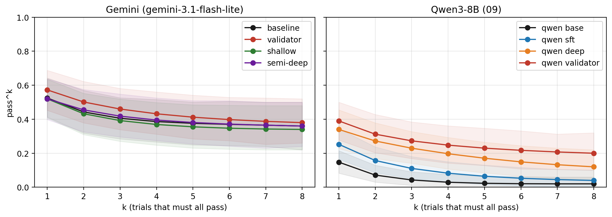
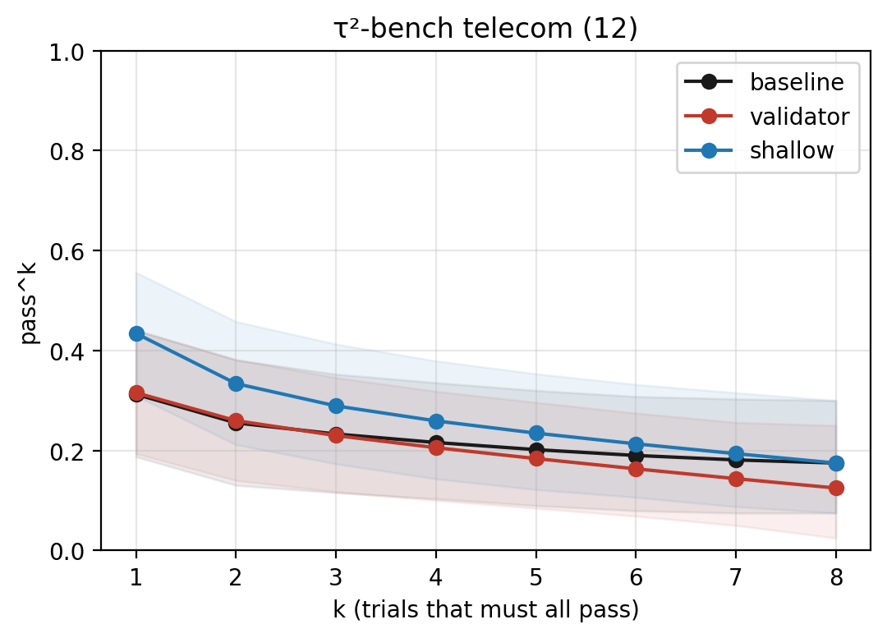

# policy-graph-agents

**Does turning an LLM agent's text policy into a graph make it follow the rules more consistently?**

I test this on the airline domain of [τ-bench](https://github.com/sierra-research/tau-bench), a benchmark where an LLM customer-service agent talks to an LLM-simulated customer and calls tools (book, change, cancel flights) on a real database. As a stretch goal, I repeat the main test on the telecom domain of [τ²-bench](https://github.com/sierra-research/tau2-bench), where the user also runs tools on their own phone.

---

## Situation

A customer-service agent gets a long policy written in plain text (`wiki.md`): "do not cancel a trip that has already been flown", "get an explicit *yes* from the user before you change anything", and so on.

The policy is already in the agent's prompt, but the agent does not follow it every time. τ-bench measures this with **pass^k**: a task counts only if the agent solves it in *all* k tries. In my baseline, the same task often passes in one try and fails in the next under the exact same settings.

## Task

I wanted to answer three questions:

- **RQ1:** If the policy is written as a **graph** (structured knowledge) instead of prose, does the agent become more consistent?
- **RQ2:** Does it matter **how deeply** the graph is used: only in the prompt (*shallow*), checked step by step before each action (*semi-deep*), or trained into the model (*deep*)?
- **H1:** If this Knowledge-infused Learning (KiL) really helps, it should beat a simple **runtime validator**: the same rules written as code that blocks bad tool calls. If the validator is just as good, the rules belong in code, not in the model.

## Action

1. **Built the policy graph.** I converted all 26 bullets of `wiki.md` into a graph: 7 actions, 29 rules, 19 "ask the user first" items, 6 OR/AND gates. Every rule keeps its source id (G1, C3, ...), and I checked each one against the original text. I tagged each rule as *data* (checkable from the database, 24 rules) or *dialogue* (only visible in the conversation, 5 rules). The graph is stored as JSON and loaded into Neo4j (70 nodes, 70 relationships).
2. **Chose a model under a small budget.** I tried free options first (Groq API, Qwen3-8B, Qwen3-32B on Colab GPUs, free Gemini tiers) and recorded why each did not work. I settled on `gemini-3.1-flash-lite` through the paid Gemini API, after a 10-task pilot to check it and estimate cost.
3. **Ran every arm the same way.** Same agent, model, prompt, and settings; 50 tasks × 8 trials = 400 dialogues per arm. I report pass^k for k = 1..8 with 95% bootstrap confidence intervals and paired comparisons over the same tasks.
4. **Built the arms (Gemini):**
   - **Baseline:** prose policy only.
   - **Runtime validator:** the 24 data rules as Python code. It checks every write tool call before it reaches the database and blocks it with the name of the broken rule.
   - **Shallow KiL:** the graph rendered as a structured rule list and added to the prompt.
   - **Semi-deep KiL:** before each write call, the rules for that one action are pulled from the graph and the agent must check them one by one.
5. **Built deep KiL on an open model.** Deep KiL changes the model's weights with my own loss, which the Gemini API does not allow. So I used **Qwen3-8B** (LoRA, one A100 40 GB) as the agent and kept the same Gemini user simulator. Training data come from the 1,600 Gemini dialogues: passing, rule-following dialogues as positives, and rule-breaking write calls (found by the validator's checker) as negatives. Loss = next-token loss + 0.5 × a penalty on the violating calls. Tasks are split into 5 folds, so no adapter is tested on a task it saw in training. Four arms on the same model: `qwen_base` (no training), `qwen_sft` (fine-tuning only, no penalty), `qwen_deep` (fine-tuning + penalty = **deep KiL**), `qwen_validator` (H1 control).
6. **Compared all arms and read failed dialogues by hand.** Violations in three types (illegal tool calls, dialogue rules, reasoning/argument errors), the τ-bench failure categories, and a hand-check of 30 failed dialogues: is the error the agent's, the simulator's, or the benchmark's?
7. **Tested the tools, not just the agent.** I ran the validator on τ-bench's own answer keys. This is how I found that some answer keys break the written policy (see Result).
8. **Repeated the main test on τ²-bench telecom.** 40 test tasks × 8 trials; baseline, validator (5 data rules), and shallow KiL with a new telecom policy graph (8 global rules, 12 action conditions, 3 troubleshooting procedures with 17 user-side steps). I compared the arms the same way as for airline (paired tests, results by issue type, violations replayed from the saved dialogues) and read 15 failed dialogues by hand. Semi-deep and deep KiL were not run on telecom: the budget was used up, and most fixes happen on the user's phone, where a per-action rule check does not apply.
9. **Checked the newer answer keys.** I ran my airline validator on τ²-bench's *airline* answer keys to see if the 8 broken answer keys from τ-bench are still there.
10. **Used AI tools in the workflow.** I used an AI coding assistant to draft code and the first version of the graph JSON. I verified the output with tests (for example, replaying every answer key through the validator) and by reading logs. One bug, a user-simulator setting that differed between arms, was caught this way and fixed before any result was used. For both hand-checks, AI first suggested a label for each dialogue; I read every dialogue and confirmed or changed the label.

## Result

### τ-bench airline (50 tasks × 8 trials per arm)

| Model | Arm | pass^1 | pass^8 | Drop 1→8 | Illegal tool calls executed |
|---|---|---|---|---|---|
| Gemini (05G–08) | Baseline (prose policy) | 0.525 | 0.360 | 31% | 70 |
| Gemini (05G–08) | Runtime validator | **0.573** | **0.380** | 34% | 0 (69 blocked) |
| Gemini (05G–08) | Shallow KiL | 0.520 | 0.340 | 35% | 31 |
| Gemini (05G–08) | Semi-deep KiL | 0.520 | 0.360 | 31% | 2 |
| Qwen3-8B (09) | Base | 0.147 | 0.020 | 86% | 349 |
| Qwen3-8B (09) | SFT (no penalty) | 0.253 | 0.040 | 84% | 182 |
| Qwen3-8B (09) | Deep KiL | 0.340 | 0.120 | 65% | 76 |
| Qwen3-8B (09) | Runtime validator | **0.390** | **0.200** | 49% | 0 (407 blocked) |

Each model is compared only with its own arms (the agent model differs).



*pass^k curves with 95% bootstrap CI. Left: gemini-3.1-flash-lite arms (notebooks 05G–08). Right: Qwen3-8B arms (notebook 09). This graph is from notebook 10.*

**What I found**

- **H1 is refuted.** No KiL arm beats the validator of its own model. On the 42 clean tasks the validator is higher at every k; the gap is significant for shallow (k = 1, 2, 4) and semi-deep (k = 1), and not significant for deep KiL.
- **The baseline is not consistent.** Gemini solves about half of the tasks once, but only about a third every time. 19 of 50 tasks pass in some trials and fail in others.
- **The validator stops every checkable violation** and raises pass^1 by about 10 points on the clean tasks (+0.104, 95% CI [+0.033, +0.185]). But pass^8 barely moves (+0.048, not significant).
- **KiL cuts violations, but not failures.** Illegal calls fall from 70 to 31 (shallow) and 2 (semi-deep) on Gemini, and from 349 to 76 on Qwen with deep KiL. But the agent becomes more cautious and leaves more required actions undone (missing actions: Gemini 110 → 151 with semi-deep; Qwen 99 → 205 with deep), so pass^k does not rise.
- **Deep KiL works compared with plain fine-tuning.** Deep beats SFT at every k (clean 42: pass^1 +0.104, pass^8 +0.095, both significant), so the gain comes from the graph-based penalty, not only from the training data.
- **Final-state scoring hides violations.** 13% of Gemini baseline's passing dialogues still break a rule (20% for Qwen base).
- **Hand-check of 30 failed dialogues:** the agent caused 20, the simulator 5, the benchmark 4, unclear 1.
- **Side findings about the benchmark:**
  - 8 of the 50 airline answer keys (tasks 10, 16, 19, 26, 27, 34, 45, 46) break τ-bench's own written policy. For example, task 26's answer key cancels a trip that has already been flown. I report results on all 50 tasks and on the 42 clean tasks.
  - `update_reservation_flights` changes the flights but does not save a new cabin class.
  - **τ²-bench fixed all 8 broken answer keys.** On τ²-bench's airline answer keys my validator finds 0 tasks that break the policy (τ-bench: 8). In 6 of the 8, the new answer key makes no write call at all (the right answer is to refuse); in tasks 16 and 19 it uses a different write call that follows the policy. This supports reporting the 42 clean tasks separately. (Checked with my 24 data rules only; notebook 13.)

### τ²-bench telecom (40 tasks × 8 trials per arm)

| Arm | pass^1 | pass^8 | Drop 1→8 | User tool calls / dialogue | Blocked calls | Cost (USD) |
|---|---|---|---|---|---|---|
| Baseline | 0.312 | 0.175 | 44% | 2.5 | 0 | 17.28 |
| Runtime validator | 0.316 | 0.125 | 60% | 2.4 | 45 | 16.32 |
| Shallow KiL | **0.434** | 0.175 | 60% | **4.5** | 0 | 19.92 |



*pass^k curves with 95% bootstrap CI for the three telecom arms (notebook 13).*

**Paired Δ over the same 40 tasks (95% bootstrap CI, \* = significant; notebook 13)**

| Compare | Δpass^1 | Δpass^2 | Δpass^4 | Δpass^8 |
|---|---|---|---|---|
| Shallow − validator | **+0.119 [+0.056, +0.188] \*** | **+0.074 [+0.014, +0.143] \*** | +0.054 [−0.022, +0.132] | +0.050 [−0.075, +0.175] |
| Shallow − baseline | **+0.122 [+0.059, +0.191] \*** | **+0.079 [+0.018, +0.149] \*** | +0.043 [−0.023, +0.117] | +0.000 [−0.100, +0.100] |
| Validator − baseline | +0.003 [−0.028, +0.034] | +0.004 [−0.023, +0.034] | −0.010 [−0.061, +0.041] | −0.050 [−0.150, +0.050] |

**What I found**

- **Here shallow KiL beats the validator, unlike airline,** at pass^1 and pass^2 (significant). The gain is mostly on mobile-data tasks (pass^1 0.472 vs 0.167). Service tasks are easy for every arm (about 0.75), and MMS tasks are almost never solved (pass^8 = 0 for all arms).
- **Why:** the graph's troubleshooting steps make the agent guide the user through more phone fixes (4.5 vs 2.4 user tool calls per dialogue; 40% vs 28% of the needed fixes done in failed dialogues). A validator cannot see the user's phone: it can check only 11% of the answer-key calls.
- **But the curve is not flatter.** The gap is not significant at k = 4 and 8, and shallow's pass^8 equals the baseline's (0.175). Shallow turns more "never pass" tasks into "sometimes pass" tasks (never: 19 → 11), but not into "always pass" tasks. So H1, as stated, is not supported here either.
- **The validator does not change the score** (no Δ is significant), but it stops every checkable violation: 45 calls blocked.
- **Final-state scoring hides violations.** 46 of the baseline's 100 passing dialogues resume a line whose contract has ended, which `main_policy.md` forbids ("not allowed … even if the user has paid"), and still get full reward (shallow: 36 of 139; validator: 0).
- **Hand-check of 15 failed dialogues (5 per arm):** the agent caused all 15. The common pattern: the agent calls tools that only exist on the user's phone (e.g. `toggle_airplane_mode`), gets "not found", and transfers to a human instead of telling the user what to do (13 of 15 end in a transfer).

---

## Repository layout

The files sit in one flat folder on purpose: the notebooks import the `.py` files and read the `results_*` folders from the same folder, so the repo can be dropped into Colab and run as it is.

```
notebooks/
  01_TauBench_Phase0_Setup.ipynb     clone and install tau-bench, first checks
  02_TauBench_vLLM_Pilot.ipynb       pilot with Qwen3-8B on vLLM (early phase)
  03_TauBench_Qwen32B_Pilot.ipynb    pilot with Qwen3-32B (early phase)
  04_Policy_Graph.ipynb              build the graph, load it into Neo4j, draw it
  05_Baseline_PassK.ipynb            Qwen3-32B baseline (early phase, replaced by 05G)
  05G_Gemini_Baseline.ipynb          baseline arm
  06G_Gemini_Validator.ipynb         runtime validator arm + answer-key test
  07_Gemini_Shallow_KiL.ipynb        shallow KiL arm
  08_Gemini_SemiDeep_KiL.ipynb       semi-deep KiL arm
  09_Deep_KiL.ipynb                  deep KiL on Qwen3-8B (base, sft, deep, validator)
  10_Compare_All_Arms.ipynb          all arms side by side, violation types, hand-check
  11_Tau2_Telecom_Setup.ipynb        tau2-bench install and 5-task pilot
  12_Tau2_Telecom_Arms.ipynb         telecom baseline, validator, shallow KiL
  13_Tau2_Telecom_Compare.ipynb      telecom comparison, hand-check, tau2 airline answer-key check

airline_policy_graph.json            the airline policy graph (master copy)
settings_gemini.py                   settings shared by every Gemini arm
gemini_run.py                        runs tau-bench with Gemini and logs every call
policy_checker.py                    the 24 data rules as code
validator_gemini.py                  the runtime validator arm
violations.py                        counts violations in saved dialogues
graph_text.py, kil_run.py            shallow / semi-deep arms
deep_data.py, deep_train.py,
deep_run.py, settings_deep.py        deep KiL: training data, LoRA training, evaluation
compare.py, passk.py                 comparison of all arms, pass^k and bootstrap CI
load_neo4j.py, graph_draw.py         Neo4j import and graph pictures
settings.py, pilot_*.py, ...         early Qwen phase (01-05)
run.py, setup.py                     from tau-bench itself (MIT, Copyright Sierra)

results_gemini_<arm>/trial_1..8/     saved dialogues of each Gemini arm
results_gemini_<arm>_passk.csv       pass^k table (also _config.json, _violations.csv)
results_deep_qwen_<arm>/             saved dialogues of each Qwen arm (same file types)
results_baseline/, results_validator/,
results_pilot/, results_vllm/        early Qwen phase
results_validator_BUG_user_thinking/ the run with the simulator bug (kept as a record)
results_compare/                     tables from notebook 10; handcheck/ = 30 read dialogues
figures/                             plots used in this README and the report
tau2_telecom/                        telecom code, policy graph, and results of the 3 arms
tau2_telecom/results_compare/        tables from notebook 13; handcheck/ = 15 read dialogues
```

## How to run

All notebooks run on Google Colab. The project folder **is a clone of tau-bench with my files added on top**, because the notebooks run `pip install -e .` inside it.

**1. Set up the airline project** (in a Colab cell):

```bash
%cd /content/drive/MyDrive
!git clone https://github.com/sierra-research/tau-bench cmsc691-10-project2
!git clone https://github.com/zhang-systems/policy-graph-agents pga
!cp -r pga/. cmsc691-10-project2/ && rm -rf pga
```

The notebooks expect this exact path: `/content/drive/MyDrive/cmsc691-10-project2`.

**2. Free checks (no API cost, CPU only):**
- `10_Compare_All_Arms.ipynb`: reads the saved results of all 8 airline arms and recomputes pass^k, confidence intervals, paired tests, violation types, and the hand-check tables.
- `06G_Gemini_Validator.ipynb`, answer-key test (the cell "test the checker on tau-bench's answer key"): replays τ-bench's answer keys through the validator. Run the cells above it first; cell 3 makes one Gemini test call, so it needs `GEMINI_API_KEY`, but the cost is close to zero.
- `04_Policy_Graph.ipynb`: the last cells draw the full graph from the JSON without Neo4j.
- `13_Tau2_Telecom_Compare.ipynb`: recomputes all telecom statistics from the saved dialogues and runs the τ²-bench airline answer-key check (see step 4 for where the files go).

**3. Re-running an arm** (costs money or GPU time):

| Notebooks | Runtime | Needs | Cost per arm |
|---|---|---|---|
| 05G, 06G, 07, 08 | CPU | Colab Secret `GEMINI_API_KEY` | about $6–8 |
| 09 (deep KiL) | GPU ≥ 40 GB (A100) | `GEMINI_API_KEY` for the user simulator | about 7 GPU hours + $4 for all 4 arms |
| 04 (Neo4j part) | CPU | Neo4j Aura login in Colab Secrets | free |
| 11, 12 (telecom) | CPU | `GEMINI_API_KEY` | about $16–20 |

**4. Telecom:** open `11_Tau2_Telecom_Setup.ipynb` and then `12_Tau2_Telecom_Arms.ipynb` in Colab. They create `/content/drive/MyDrive/cmsc691-10-tau2`, clone τ²-bench at commit `da0835f`, and write all their own code files. The saved results are in `tau2_telecom/results/`. To analyze them without re-running, run the install cells of 11, copy each result to `tau2-bench/data/simulations/telecom_<arm>/results.json`, copy `tau2_telecom/*.py` into `cmsc691-10-tau2/`, and run `13_Tau2_Telecom_Compare.ipynb` (free, CPU, about 2–3 minutes). Its last part also needs the airline project folder from step 1.
